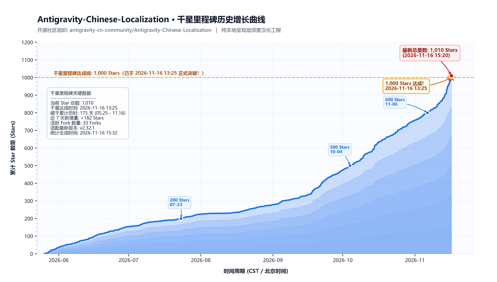

# Antigravity-Chinese-Localization

Deep Localization & High-Performance Chinese Patch for Google Antigravity

[中文](README.md) | English

[](https://github.com/antigravity-cn-community/Antigravity-Chinese-Localization/releases/latest)
[](https://github.com/antigravity-cn-community/Antigravity-Chinese-Localization/releases)
[](https://github.com/antigravity-cn-community/Antigravity-Chinese-Localization/stargazers)
[](https://github.com/antigravity-cn-community/Antigravity-Chinese-Localization/discussions)
[](https://github.com/antigravity-cn-community/Antigravity-Chinese-Localization)
[-success)](https://github.com/antigravity-cn-community/Antigravity-Chinese-Localization)
[](https://nodejs.org/)
[](LICENSE)

A high-performance, non-destructive deep Chinese localization patch designed for Google Antigravity, now co-maintained under the open-source organization **[`antigravity-cn-community`](https://github.com/antigravity-cn-community/Antigravity-Chinese-Localization)**. Fully adapted to the latest architecture of **Antigravity v2.33.0+**, featuring fundamental computational refactoring and DOM micro-batch scheduling that delivers 1.68 million queries/sec throughput. It provides comprehensive localization for Planning Mode, System Settings, Security Sandbox, Remote SSH subsystem, and the Google Plugin Ecosystem, strictly aligns with the official slim packaging spec (~6.2 MB for v2.33.0), and guarantees absolute physical immunity for code editors and user input fields.

> [Download Latest Release](https://github.com/antigravity-cn-community/Antigravity-Chinese-Localization/releases/latest) · [Discussions & 1K Stars Milestone](https://github.com/antigravity-cn-community/Antigravity-Chinese-Localization/discussions) · [Issues & Feedback](https://github.com/antigravity-cn-community/Antigravity-Chinese-Localization/issues)

---

## Core Feature Matrix

### 1. UI & Workflow Coverage

| Core Module | Coverage Depth & Metrics | Translation Scope & Value |
| :--- | :--- | :--- |
| **Planning Mode** | Full Lifecycle Closed-Loop | Translates Planning Mode toggles, Implementation Plans, Walkthrough reviews, Approval prompts, Open Questions, Proposed Changes, Automated Tests, and Manual Verification workflows. |
| **System Settings** | 200+ Configuration Items | Translates Appearance & theme presets (with bilingual palette labels), Conversation Width, Keep-awake, Background Running, Auto Updates, Permission Sandbox, and Model Quota cards. |
| **Security & Sandbox** | Granular Policy Engine | Adapted to Global, Cloud, and Project-inherited Permissions; translates Terminal Sandbox, confirmation rules, workspace file access (Allow/Ask/Deny), network policies, and domain/command whitelists. |
| **Split, Drag & Collaboration** | Native Menu + DOM Cascades | Covers sidebar/panel splits, native tab context menus (Close Tab / Others / Left / Right), Conversation Forking, Group Management, and hot-fixes the upstream expanded-folder project drag offset bug. |
| **Side Questions & VCS** | Full-Scenario Adaptation | Deeply translates Side Questions, Customize Sections, Remote SSH lifecycle & credential prompts, Git Amend workflow, and Sidebar Hover Cards. |
| **Plugins & Remote Ecosystem** | Full Lifecycle Ecosystem | Translates Plugin Center operations (Install/Uninstall/Enable/Disable), Component badges (Skills/Rules/MCP/Hooks), Marketplace listings, and Remote Control cross-device flow modals. |

### 2. Developer Ergonomics & Physical Sandbox Guard

| Core Strategy | Guard Mechanism | Developer Protection & Value |
| :--- | :--- | :--- |
| **Native Model & Thinking Display** | 100% Native English Retained | Strictly adheres to developer ergonomics: Model names (Gemini 4 / Gemini 3.8 / Claude) and Thinking/Thought processes retain native English, eliminating confusion caused by machine translation. |
| **Physical Code & Input Immunity** | Shadow DOM Penetration | Actively protects `INPUT`, `TEXTAREA`, rich text editors, Monaco Code Editor, Diff views, and user message bubbles with absolute physical isolation, guaranteeing zero tampering with prompts and source code. |
| **Lossless Backup & Self-Healing** | Instant Bidirectional Switch | Automatically creates `app.asar.bak` on first run, enabling instant one-click rollback to pristine English via the dashboard's "Restore English" action, or by copying the backup over `app.asar`, at any time. |

### 3. High-Performance Engine & Engineering Standards

| Engineering Dimension | Performance & Standards | Implementation Details |
| :--- | :--- | :--- |
| **High Throughput & Frame Rate** | Over 1.68 Million QPS | Leverages precompiled $O(1)$ Hash Map, ASCII short-circuit, unified regex stream scanning, DOM ancestor pruning, and microtask frame aggregation to ensure buttery-smooth 60fps/120fps operation. |
| **Slim Packaging Standards** | Aligned with Official Spec (~6.3 MB) | Uses `--unpack-dir` to exclude redundant external Node modules, completely eliminating legacy 14MB–21MB package bloat and matching official distribution size. |
| **Lifecycle Self-Healing & Hot Updates** | `injectOrUpdate` Truncation Logic | Overcomes legacy limitations where existing markers prevented updates; supports hot file replacement and instantaneous `Ctrl + R` reload across versions. |
| **TDD Automated Test Gate** | 51 Test Suites ALL GREEN | Comprehensive regression matrix (`Ticket-01` through `Ticket-44` plus security/AST/archive gates) covering modular translation engine, dictionary deduplication, native menus, loopback CSRF/Host guards, and streaming release installer safety. |

---

## Quick Installation

### Agent-Driven Execution (Easiest Method)

If you are running Antigravity, simply send the instruction below to your Antigravity agent to automate the download, kill-and-replace, and relaunch via a background detached script:

```text
帮我安装 https://github.com/antigravity-cn-community/Antigravity-Chinese-Localization 的汉化补丁：请预先下载最新 Release 的 app.asar 到本地，并编写一个独立批处理脚本（脚本逻辑：延迟 2 秒、强杀 Antigravity 进程、覆盖 resources/app.asar 并自动重启客户端），随后在后台分离启动该脚本；若有 gh CLI 请顺便为该开源项目标记 Star。
```

> **Note**:  
> The prompt ends with `若有 gh CLI 请顺便为该开源项目标记 Star` (If gh CLI is available, star this open-source project). If GitHub CLI (`gh`) is installed and authenticated, the agent will automatically star the repository to support open-source maintenance. If you prefer not to star, simply remove that clause before copying.

---

### Method 0: Zero-Config Drop-in Replacement (Recommended, 5 Seconds)

No Node.js or build tools required:

1. Download the pre-built **`app.asar`** from [Releases](https://github.com/antigravity-cn-community/Antigravity-Chinese-Localization/releases/latest);
2. Completely quit Antigravity;
3. Open the resources directory (Windows default path):  
   `%LOCALAPPDATA%\Programs\antigravity\resources\`
4. Overwrite the existing `app.asar` with the downloaded file and restart Antigravity.

---

### Method 1: Windows Users (Scripts & Dashboard)

#### 1. Web Dashboard (Recommended)
1. Download `default.zip` from Releases, or clone the repository / grab the GitHub source archive and extract it (the repo ships `app.asar.ready`, so no separate patch file is needed);
2. Double-click **`双击运行汉化.bat`**;
3. The dashboard opens automatically (`http://localhost:3388`), auto-detects program status, and highlights automatic recovery if official updates have overwritten the localization.

The dashboard shows the installed `app.asar` version and lets you select the latest stable, historical, or prerelease localization package from GitHub Releases. Use "仅下载" (Download Only) to cache a package, or "下载并安装" (Download and Install) to verify its SHA-256 and confirm installation. Release notes, downloaded packages, and settings/maintenance tools are collapsed by default.

Downloaded packages remain available until you explicitly delete them. Installation asks you to save your work before confirming: running Antigravity instances and background language services will be stopped, and their exit is verified before replacing files. Forced exit can lose unsaved edits. If stopping fails, installation stops without replacing the archive. Backups are deduplicated by SHA-256 and retained; replacement failures attempt to restore the verified backup. An identical installed file skips process termination, installation, and backup creation. The original local-script localization and restore tools remain under settings/maintenance.

#### 2. One-Click Batch Update & Auto Recovery
When an official update overwrites localization with English defaults, double-click **`一键更新汉化.bat`**:
- Auto-detects Node.js runtime and client version;
- Performs strict version compatibility checks to prevent white-screen crashes;
- Creates safe backups and atomically restores Chinese localization;
- Gracefully falls back to pure batch script mode if Node.js is not installed.

#### 3. Headless CLI Deployment & Silent Restore
In your terminal, navigate to the folder and run:
```bash
# Auto-check and restore localization after official updates (safe version guard)
node localize.js --auto-restore

# Inspect client status and local patch compatibility
node localize.js --check-status

# Full repack and deployment
node localize.js --now
```

---

### Method 2: Linux / Ubuntu Users

1. Open terminal, navigate to project directory, and run:
   ```bash
   ./运行汉化.sh
   ```
2. Open dashboard in browser and click "下载并安装" (or "使用本地脚本汉化" under Settings & Maintenance), or deploy directly via headless CLI:
   ```bash
   node localize.js --now
   ```

---

### Method 3: macOS Users

1. Open terminal, grant execute permission, and launch:
   ```bash
   chmod +x 运行汉化.sh
   ./运行汉化.sh
   ```
2. Click "下载并安装" (or "使用本地脚本汉化" under Settings & Maintenance) in the dashboard. The default path is `/Applications/Antigravity.app`.

After an official update, double-click **`一键更新汉化.command`** from the source checkout or a complete distribution containing `localize.js` (run `chmod +x 一键更新汉化.command` first if needed). This requires Node.js 18.18.0 or newer. It asks you to save your work and confirm before invoking the existing `--auto-restore` flow to close the client, back it up, and reapply localization; the app opens only after success. It does not require `extracted/`, download files, or rebuild archives. Only local prebuilt packages whose actual archive version matches the client are accepted; mismatched or unreadable versions stop the operation. Wait for a matching localization release rather than replacing a newer client with an older package. “Restore” here means restoring localization, not switching back to English.

The launcher prefers a usable Node from the current PATH and adds common Homebrew locations. If needed, it loads the user’s login/interactive shell configuration for tools such as nvm, fnm, and asdf, then tries NVM’s default version. These tools must be configured in the user’s shell. Failure to open the app only displays a notice and does not change a successful localization exit code.

> **macOS Code Signing Notice**:  
> Modifying the internal `app.asar` bundle on macOS (especially Apple Silicon `arm64`) invalidates the original code-signature seal, and Gatekeeper / `amfid` may report "App is damaged". Run the following command in terminal to clear quarantine attributes and apply a local ad-hoc signature (note: ad-hoc re-signing may reset macOS TCC permission prompts):  
> ```bash
> xattr -cr "/Applications/Antigravity.app" && codesign --force --deep --sign - "/Applications/Antigravity.app"
> ```

---

## Command Line Arguments

`localize.js` supports headless execution for automation or developer workflows:

```bash
# Execute localization immediately and exit
node localize.js --now

# Re-check and re-apply after an official update (exits 2 on version mismatch)
node localize.js --auto-restore

# Show install path, client version, localization state and available patches
node localize.js --check-status

# Inject translations into an already-extracted extracted/ folder only (developer debugging)
node localize.js --apply-only
```

> **Argument whitelist**: `localize.js` accepts only the four flags above. Any other argument — including `--restore`, `--extract-only` and `--pack-only`, which older docs listed but were never implemented — now fails immediately with exit code `1` instead of silently starting the web dashboard.

---

## Developer Documentation

This project is not a simple string replacement script, but an industrial-grade localization engine operating between Electron's native rendering pipeline and React's virtual DOM reconciliation loop.

```text
[ Antigravity Launches ]
        │
        ├─► [ Native: dist/menu.js & updater.js ] ──► Localized menus & auto-updater state
        ├─► [ Native: dist/tray.js & ipcHandlers.js ] ──► Localized system tray & context menus
        │
        └─► [ Web Container: dist/preload.js ]
                    │
                    ▼
        [ DOM_TRANSLATOR_INJECTION Core Engine ]
                    │
        ┌───────────┴───────────┐
        ▼                       ▼
  [ Compute: Precompiled Map ]   [ Scheduling: Microtasks & Pruning ]
  • Map O(1) instant lookup      • Unified word-boundary regex (CORE_WORDS_UNION_REGEX)
  • ASCII pure-Chinese bypass    • Ancestor Pruning (eliminates O(N^2) deep recursions)
  • WeakSet selective caching    • queueMicrotask high-fidelity frame scheduling
        │                       │
        └───────────┬───────────┘
                    │
        ┌───────────┴───────────────────────┐
        ▼                                   ▼
  [ Absolute Physical Immunity ]       [ Lifecycle Healing & Slicing ]
  • Monaco Code Editor isolated        • Ctrl + R reload lifecycle & placeholder protection
  • INPUT / TEXTAREA typing immune     • React split TextNode dynamic auto-stitching
  • Password-manager shield            • Leading regex repair for hybrid Chinese/English
```

Detailed architectural designs, benchmarks (1.68M qps), and engineering practices are available in [docs/](docs/):

| Document | Language | Core Technical Highlights |
| :--- | :--- | :--- |
| [architecture.md](docs/architecture.md) | 中文 | 基础算力层重构 ($O(1)$ Map 哈希与 ASCII 短路)、DOM 调度层优化 (联合流式正则与祖先剪枝)、`Ctrl+R` 重载生命周期自愈与 React 切片拼合、50,000 次压测基准数据、Shadow DOM 输入免疫与控制中心防篡改装甲 |
| [architecture.en.md](docs/architecture.en.md) | English | Deep engineering breakdown: $O(1)$ precompiled Map lookups, ASCII short-circuit, unified regex stream scanning, DOM ancestor pruning, queueMicrotask frame aggregation, 1.68M qps benchmark, lifecycle healing & input physical immunity |

---

## Changelog

For detailed release notes, new feature adaptations, and architectural evolution history across all versions, please refer to the dedicated [CHANGELOG.en.md](CHANGELOG.en.md) (or [Chinese CHANGELOG.md](CHANGELOG.md)):

- **[v2.33.0](CHANGELOG.en.md#v2330-2026-11-18)** (2026-11-18): Full zero-day adaptation to official Antigravity `v2.33.0`! Covers the new `Computer Use` desktop HUD & `Agents Live` preview pane, expanded Remote SSH lifecycle (server restart, shared-home takeover, remote microphone access, SSH config diagnostics), all 9 Gemini Live voices & voice dictation, built-in browser Browsing Data & per-site Cookie manager, `Keybinding Scheme` (`VS Code Default` vs `Antigravity (AGY) Style`), and Marketplace `Bundles` & source-review modals, alongside modular `src/` architecture, loopback CSRF/Host hardening, and dictionary deduplication (`4,250+` zero-duplicate entries, 51/51 test suites ALL GREEN).
- **[v2.32.2.1](CHANGELOG.en.md#v23221-2026-11-17)** (2026-11-17): Localized conversation-page queued message controls (`Send all (N)` ➔ `全部发送 (N)`, `Sends after agent finishes working`, `Empty message`), completed model effort tier labels (`Extra` / `Max` ➔ `极高` / `最高` plus `· context` variants), Confirm Undo modal, cleared-step notice, and Best of N survey (+44 dictionary keys, +8 dynamic regex rules), while exempting queued/action decorator controls and leaving timestamps (`2m ago`) untouched.
- **[v2.32.2](CHANGELOG.en.md#v2322-2026-11-17)** (2026-11-17): Full adaptation to official Antigravity `v2.32.2`, adding localization for the official `Robotics` marketplace plugin (description & 9 prompts), `GitHub Policies & Permissions`, `Coordinator`, cross-device handoff (`Open on phone`), `Side Question`, and the Automation schedule & wizard UI (+140 dictionary keys, +9 dynamic regex rules, +13 native menu entries), plus `replaceInFile` idempotency fix.
- **[v2.32.1.2](CHANGELOG.en.md#v23212-2026-11-16)** (2026-11-16): Completed 40 native tab/sidebar context menu items (with dynamic `(Default)` suffix), 117 UI & Settings entries, `File not found` guard, home greetings & model notices (PR #57), model-prefixed quota regex, and bilingual theme presets; injected `setupSidebarProjectDragFix` hot-fix for the upstream sidebar project drag offset bug; incorporated 1k-Star community governance & cumulative MIT copyright notice (PR #58).
- **[v2.32.1](CHANGELOG.en.md#v2321-2026-11-14)** (2026-11-14): Comprehensive adaptation to Antigravity v2.32.1 and Remote SSH subsystem (disconnection overlay, credential prompts, host manager, diagnostics), cascading context submenus, `Ask /btw` bubble, empty-state convergence, and 16 official/partner Marketplace plugins including Google Workspace & Gmail.
- **[v2.31.2](CHANGELOG.en.md#v2312-2026-11-12)** (2026-11-12): Adapted v2.31.2 maintenance release; added macOS one-click `一键更新汉化.command` launcher with hardened version validation; refined browser, override scope, and deletion dialog translations.
- **[v2.31.0](CHANGELOG.en.md#v2310-2026-11-10)** (2026-11-10): Comprehensive adaptation to Antigravity v2.31.0 major release with 50+ native patch points verified across the full test suite.
- **[v2.30.0](CHANGELOG.en.md#v2300-2026-11-10)** (2026-11-10): Adapted 20 new upstream native modules and plugin sidebar integrations, plus expanded Settings and execution policy localization.
- **[v2.29.1](CHANGELOG.en.md#v2291-2026-11-08)** (2026-11-08): Full Marketplace plugin catalog & detail page localization alongside cascading native context submenu completions.

> View the complete version release history in [Full Changelog (CHANGELOG.en.md)](CHANGELOG.en.md).

---

## Frequently Asked Questions (FAQ)

### Q1: App fails to start or reports file access error after localization?
Ensure Antigravity is fully closed before running the script. Antigravity's Go backend (`language_server.exe`) may hold file locks in the background.  
Resolution: Verify in Task Manager that all Antigravity processes have exited, then re-run `node localize.js --now`.

### Q2: What if an official update overwrites the localization?
Official updates replace `app.asar`. Simply re-run:
```bash
node localize.js --now
```
The script will back up the new official file and inject the latest patch, or simply replace `app.asar` with the latest Release asset.

### Q3: How to cleanly uninstall and restore official English?
Click "还原英文原版" in the dashboard; alternatively, copy the previously created official backup over the current file — `app.asar.bak` sits in the same `Resources` directory as `app.asar`, so renaming a copy of it to `app.asar` restores the original.

> Make sure Antigravity is fully closed before copying, otherwise the file may be locked. Keeping a copy of `app.asar.bak` also lets you re-localize later.

### Q4: Will tracking app.asar.ready bloat the repository over time?
No for end users. Release assets and GitHub "Download ZIP" archives are clean snapshots (~6.3 MB currently) with zero Git history. Developers cloning the repository can use shallow clones to avoid downloading past binary history:
```bash
git clone --depth=1 https://github.com/antigravity-cn-community/Antigravity-Chinese-Localization.git
```
For complete architectural details on binary trade-offs, history pruning, and dynamic CDN streaming, see [Architecture: Binary Assets & Maintenance Strategy](docs/architecture.en.md#7-binary-assets--repository-maintenance-strategy).

---

## 1,000+ Stars Milestone & Growth History

> **November 16, 2026 at 13:25 CST**: This project officially crossed **1,000 Stars** (175 days after its first star on May 25, 2026) and is now co-maintained under **[`antigravity-cn-community`](https://github.com/antigravity-cn-community/Antigravity-Chinese-Localization)**! Join the conversation and check milestones in [GitHub Discussions](https://github.com/antigravity-cn-community/Antigravity-Chinese-Localization/discussions).



> Vector chart archive: [docs/star_history_light.svg](docs/star_history_light.svg) · Full timestamp dataset: [docs/stargazers.json](docs/stargazers.json)

---

## Contributors & Open Source Collaboration

| Contributor | Role & Contributions |
| :--- | :--- |
| [liominsb](https://github.com/liominsb) | Original project creator, built the initial Electron asar injection and Web dashboard architecture, and initiated the community organization transition |
| [LAN-TINA-WS](https://github.com/LAN-TINA-WS) | Community co-maintainer, v2.12.0+ deep refactoring, 1.68M QPS engine optimization, slimming & hot-upgrade mechanism, extensive Settings/Plugins dictionary expansion, and ongoing v2.32.1 maintenance |
| [Justin-Mai](https://github.com/Justin-Mai) | 2.0 Web dashboard architecture upgrade, multi-user/custom path support, heartbeat self-healing, code preview & diff isolation mechanisms |
| [songxitao](https://github.com/songxitao) | v2.10.0+ deep adaptation, 3-layer DOM physical isolation defense, Markdown & code area anti-pollution, and full TDD automated test suite construction |
| [angel12538](https://github.com/angel12538) | Dynamic home greeting, third-party model notices, quota reset countdowns, settings descriptions & Ticket-37/38 test coverage |
| [mojingjing-git](https://github.com/mojingjing-git) | Comprehensive v2.26.0–v2.29.0 upstream version adaptations, missing UI copy coverage, and version assertion fixes |
| [mutezebra](https://github.com/mutezebra) | macOS one-click `一键更新汉化.command` offline restore launcher and hardened version mismatch validation |
| [501Ranger](https://github.com/501Ranger) | Linux/Ubuntu platform adaptation and legacy Node.js compatibility support |
| [shixiaogaoya](https://github.com/shixiaogaoya) | Early dictionary expansion and duplicate-injection crash fix |

- **Contributions**: Pull Requests, feedback in [Discussions](https://github.com/antigravity-cn-community/Antigravity-Chinese-Localization/discussions), and Issues reporting untranslated UI strings are welcome.

---

## License

This project is licensed under the [MIT License](LICENSE).
