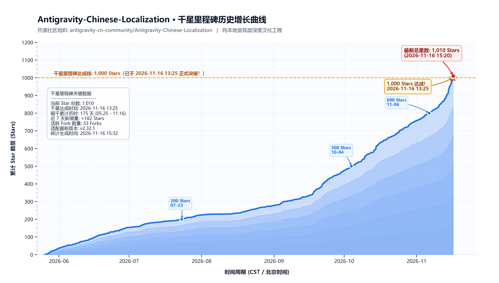

# Antigravity-Chinese-Localization

Antigravity 深度汉化与高性能本地化补丁程序

中文 | [English](README.en.md)

[](https://github.com/antigravity-cn-community/Antigravity-Chinese-Localization/releases/latest)
[](https://github.com/antigravity-cn-community/Antigravity-Chinese-Localization/releases)
[](https://github.com/antigravity-cn-community/Antigravity-Chinese-Localization/stargazers)
[](https://github.com/antigravity-cn-community/Antigravity-Chinese-Localization/discussions)
[](https://github.com/antigravity-cn-community/Antigravity-Chinese-Localization)
[-success)](https://github.com/antigravity-cn-community/Antigravity-Chinese-Localization)
[](https://nodejs.org/)
[](LICENSE)

专为 Google Antigravity 打造的高性能、非破坏性深度汉化补丁，现由开源社区组织 **[`antigravity-cn-community`](https://github.com/antigravity-cn-community/Antigravity-Chinese-Localization)** 联合维护。全面适配 **Antigravity v2.32.1+** 最新架构，深度重构基础算力层与 DOM 调度层，带来百万级吞吐量的极致流畅体验。全量汉化规划模式、系统设置、安全沙盒、Remote SSH 子系统与官方插件生态等数千条核心界面文案，严格对齐官方原生轻量级打包规格（v2.32.1 约 6.3 MB），并对用户打字与代码编辑区实施绝对物理免疫。

> [最新 Release 下载](https://github.com/antigravity-cn-community/Antigravity-Chinese-Localization/releases/latest) · [社区讨论与千星里程碑 (Discussions)](https://github.com/antigravity-cn-community/Antigravity-Chinese-Localization/discussions) · [问题反馈与建议](https://github.com/antigravity-cn-community/Antigravity-Chinese-Localization/issues)

---

## 核心特性矩阵

### 1. 全景交互与工作流深度汉化 (UI & Workflow Coverage)

| 核心模块 | 覆盖深度与技术指标 | 汉化范围与业务价值 |
| :--- | :--- | :--- |
| **规划模式 (Planning Mode)** | 全生命周期闭环深度汉化 | 覆盖规划模式开关、实施计划 (Implementation Plan)、变更回顾 (Walkthrough)、审批阻断、待确认问题、代码拟定变更及测试验证全套流程。 |
| **系统设置 (Settings)** | 200+ 设置项全景覆盖 | 汉化外观与配色预设主题（含中英双语配色标识）、对话流宽度自适应、防休眠、后台保活、自动检查更新、权限沙盒与模型配额卡片。 |
| **安全与权限沙盒 (Permissions)** | 粒度精细化安全策略 | 适配全局权限、云端权限与项目继承架构，汉化终端沙盒、沙盒外命令确认、文件访问策略（允许/询问/拒绝）、网络策略及域名/命令黑白名单。 |
| **会话分屏、拖拽与多维协作** | 原生菜单 + DOM 级联全覆盖 | 全面覆盖左右侧栏分屏、标签页原生右键菜单（关闭标签/其他/左侧/右侧）、会话派生 (Fork)、分组管理，并修复左侧栏展开状态项目拖拽偏移问题。 |
| **侧边问答与版本控制 (Side Q & VCS)** | 全场景深度交互适配 | 深度汉化侧边问答系统、自定义分区、Remote SSH 连接生命周期与凭据弹窗、源码控制 Git Amend（追加提交）及悬停卡片。 |
| **官方插件与远程生态 (Plugins & Remote)** | 全生命周期生态管理 | 深度汉化插件中心全套操作、构件标签（Skills/Rules/MCP/Hooks）、扩展市场生态详情页以及远程控制（Remote Control）跨设备流转弹窗。 |

### 2. 专业开发哲学与物理安全装甲 (Ergonomics & Physical Sandbox)

| 核心策略 | 防护机制与实现方案 | 业务价值与开发者保障 |
| :--- | :--- | :--- |
| **模型与思考链原生保留** | 100% 保持官方英文原生 | 严格遵循专业开发习惯，模型名称（Gemini 4 / Gemini 3.8 / Claude 等）及思考链（Thinking / Thought 过程）保留原生英文，杜绝机器硬翻引起的认知歧义。 |
| **编辑器与输入物理免疫** | Shadow DOM 穿透隔离 | 智能免疫 `INPUT`、`TEXTAREA`、富文本输入框、Monaco 代码编辑器、Diff 比对器与用户对话气泡，绝对物理隔离，严禁篡改用户编写的代码与 Prompt。 |
| **无损备份与一键自愈** | 双向无损瞬时切换 | 首次部署自动生成官方原版 `app.asar.bak`，支持随时通过控制面板「还原英文原版」或直接用备份覆盖 `app.asar`，毫秒级无损还原至官方纯英文状态。 |

### 3. 工业级底层算力与工程工艺 (High-Performance Engine & Engineering)

| 工程维度 | 性能指标与工程标准 | 底层技术实现 |
| :--- | :--- | :--- |
| **极致吞吐与高帧率调度** | 吞吐量突破 168 万次/秒 | 采用预编译 $O(1)$ 哈希索引、纯中文 ASCII 极速短路、联合流式正则、DOM 树祖先剪枝与微任务帧聚合调度，全面保障 60fps/120fps 满帧无感运行。 |
| **轻量打包与标准规格** | 严格对齐官方原生规格（约 6.3 MB） | 使用 `--unpack-dir` 排除外部冗余依赖，彻底消除历史版本 14MB~21MB 的体积膨胀问题，与官方原生分发包规格保持一致。 |
| **生命周期自愈与热升级** | `injectOrUpdate` 截断更新 | 解决旧版因检测到历史标记而跳过更新的缺陷，无论是全新安装、日常热覆盖还是跨版本升级，均支持热注入与 `Ctrl + R` 瞬时重载自愈。 |
| **全套 TDD 自动化测试门禁** | 42 组测试套件 ALL GREEN | 覆盖词典去重基线、首页动态文案、原生菜单、AST 语法门禁、文件与进程安全校验以及流式发布下载防护，杜绝回归与启动崩溃。 |

---

## 快速安装指南

本补丁提供多种灵活的安装方式，满足普通用户与开发者的不同场景需求：

### 智能体一键指令（最简模式，直接复制给 Antigravity）

如果您正在运行 Antigravity，可直接将下方指令发送给当前智能体，即可自动下载最新补丁并在后台执行一键静默安装与重启：

```text
帮我安装 https://github.com/antigravity-cn-community/Antigravity-Chinese-Localization 的汉化补丁：请预先下载最新 Release 的 app.asar 到本地，并编写一个独立批处理脚本（脚本逻辑：延迟 2 秒、强杀 Antigravity 进程、覆盖 resources/app.asar 并自动重启客户端），随后在后台分离启动该脚本；若有 gh CLI 请顺便为该开源项目标记 Star。
```

> **说明与提示**：  
> 该一键指令末尾包含 `若有 gh CLI 请顺便为该开源项目标记 Star`。当您的系统安装并登录了 GitHub CLI（gh）时，智能体会协助为本项目点亮 Star 以支持开源维护。如果您不希望自动标记 Star，直接在复制时删除该分句即可。

---

### 方式零：免环境即用覆盖

无需配置 Node.js 或任何运行环境，直接使用官方标准规格的预制核心包：

1. 前往 [Releases](https://github.com/antigravity-cn-community/Antigravity-Chinese-Localization/releases/latest) 下载预打好包的 **`app.asar`**；
2. 彻底退出正在运行的 Antigravity；
3. 打开程序目录（Windows 默认位置）：  
   `%LOCALAPPDATA%\Programs\antigravity\resources\`
4. 将下载的 `app.asar` 直接覆盖同名文件，重新启动 Antigravity 即可完成汉化。

---

### 方式一：Windows 用户（脚本与控制中心）

#### 1. 图形化控制中心（推荐）
1. 下载 Release 发布的 `default.zip`，或直接 clone 仓库 / 下载 GitHub 源码包并解压（仓库已自带 `app.asar.ready`，无需额外准备补丁文件）；
2. 双击运行目录下的 **`双击运行汉化.bat`**；
3. 浏览器会自动打开可视化控制中心（`http://localhost:3388`），系统会自动检测安装状态；若检测到官方更新覆盖，会在首页顶部醒目提示并支持一键恢复。

控制中心首页显示实际已安装的 `app.asar` 版本，可以直接读取 GitHub Releases，选择最新正式版或历史版本。“仅下载”将文件缓存到本项目的 `downloads/` 目录；“下载并安装”在下载和 SHA-256 校验后，确认安装到配置的目标路径。更新说明和已下载版本默认折叠；路径配置、本地脚本汉化、还原及日志可在“设置与维护”中展开。

各版本缓存会一直保留。用户可以在“已下载版本”列表中安装或单独删除某个缓存包；删除缓存不会修改 Antigravity 的安装文件。安装确认会提醒先保存编辑；用户确认后，如程序仍在运行，控制中心会结束所有 Antigravity 实例及后台语言服务，并严格确认进程退出后才备份和安装。强制退出可能丢失未保存的编辑；停止失败时不替换安装文件。替换失败会尝试恢复本次备份。备份按文件内容（SHA-256）去重，相同内容直接复用已有备份；当前安装文件已经与所选包一致时，跳过结束进程、安装和备份。不同内容的备份及历史备份会保留，不自动删除。原有“一键汉化”按钮继续使用本地脚本注入流程。

#### 2. 一键快速更新与官方更新恢复（双击即用）
官方客户端自动更新后会还原为英文原版，此时双击运行 **`一键更新汉化.bat`**：
- 自动检测 Node.js 环境与客户端实际版本；
- 具备严格的版本兼容性校验（避免因跨版本强行覆盖造成客户端白屏）；
- 自动备份原版并原子替换恢复汉化；
- 若系统无 Node.js 环境，则自动降级为纯批处理保底流程。

#### 3. 命令行极速部署与静默恢复（免开浏览器）
在终端中进入项目目录，执行以下命令：
```bash
# 官方更新后自动检查并恢复（匹配版本安全安装，不兼容则自动拦截）
node localize.js --auto-restore

# 查看客户端状态与本地补丁兼容性信息
node localize.js --check-status

# 直接全量重新打包并部署
node localize.js --now
```

---

### 方式二：Linux / Ubuntu 用户

1. 打开终端，进入项目目录，运行一键启动脚本：
   ```bash
   ./运行汉化.sh
   ```
2. 浏览器自动打开可视化控制面板，点击“一键汉化”。  
   或者直接通过无头命令行部署：
   ```bash
   node localize.js --now
   ```

---

### 方式三：macOS 用户

1. 打开终端，进入项目目录，赋予执行权限并运行：
   ```bash
   chmod +x 运行汉化.sh
   ./运行汉化.sh
   ```
2. 浏览器自动打开控制中心，点击“一键汉化”。默认定位路径为 `/Applications/Antigravity.app`。

官方升级后需要重新应用汉化时，可在源码目录或包含 `localize.js` 的完整分发包中双击 **`一键更新汉化.command`**（首次使用可运行 `chmod +x 一键更新汉化.command`）。需要 Node.js 14 或更新版本；执行前会提示保存工作并确认，随后调用现有 `--auto-restore` 流程关闭客户端、备份并恢复汉化，成功后打开应用。此入口不依赖 `extracted/`，不联网下载或重新打包；仅支持实际归档版本相同的本地预制包，版本不匹配或无法读取时停止。尚未发布对应版本汉化包时，请等待适配，不要用旧包覆盖新客户端。这里的“恢复”指恢复汉化，不是还原英文版。

启动器优先使用当前 PATH 中可用的 Node，并补充常见 Homebrew 路径；必要时通过用户的登录交互 shell 加载 nvm、fnm、asdf 等初始化配置，再尝试 NVM 默认版本。请确保这些工具已在自己的 shell 中正确配置。自动打开应用失败只显示提示，不会改变汉化成功的退出码。

> **macOS 代码签名提示**：  
> 在 macOS 下修改应用内部 asar 包会破坏原有的签名信息，Gatekeeper 可能会拦截并提示“应用已损坏，无法打开”。若遇到该情况，在终端中执行以下命令清除隔离属性即可恢复正常：  
> ```bash
> xattr -cr /Applications/Antigravity.app
> ```

---

## 常用命令行参数

`localize.js` 支持直接通过参数进行静默操作，适合自动化脚本或开发者快速调用：

```bash
# 立即执行汉化并静默退出（不启动 Web 界面）
node localize.js --now

# 官方更新后自动检查并恢复汉化（版本不兼容时自动拦截，退出码 2）
node localize.js --auto-restore

# 查看安装路径、客户端版本、汉化状态与可用补丁
node localize.js --check-status

# 仅对已解包的 extracted 目录注入汉化文本（开发者调试用）
node localize.js --apply-only
```

> **参数白名单**：`localize.js` 只接受上述四个参数。传入其它参数（包括旧版文档里曾出现、但从未实现的 `--restore`、`--extract-only`、`--pack-only`）会立即报错并以退出码 `1` 结束，不会再静默启动 Web 面板。

---

## 开发者文档 (Developer Documentation)

本项目并非单纯的文本查找替换脚本，而是在 Electron 原生渲染管线与 React 虚拟 DOM 调度层之间构建的一套高韧性、高吞吐的工业级本地化引擎。

```text
[ Antigravity 启动 ]
        │
        ├─► [ 原生层: dist/loadingOverlay.js ] ──► 本地化启动遮罩动画
        ├─► [ 原生层: dist/menu.js & tray.js ] ──► 本地化原生菜单栏与系统托盘
        │
        └─► [ Web 容器: dist/preload.js ]
                    │
                    ▼
        [ DOM_TRANSLATOR_INJECTION 核心引擎 ]
                    │
        ┌───────────┴───────────┐
        ▼                       ▼
  [ 算力层: 预编译哈希 ]   [ 调度层: 微任务与剪枝 ]
  • Map O(1) 极速索引     • 联合词边界流式正则 (CORE_WORDS_UNION_REGEX)
  • ASCII 纯中文极速短路   • DOM 树祖先剪枝 (消灭 O(N^2) 嵌套递归)
  • WeakSet 成功标记门禁   • queueMicrotask 高保真帧聚合调度
        │                       │
        └───────────┬───────────┘
                    │
        ┌───────────┴───────────────────────┐
        ▼                                   ▼
  [ 绝对物理免疫沙盒 ]                 [ 生命周期自愈与动态切片 ]
  • Monaco 代码编辑器物理隔离         • Ctrl + R 重载生命周期与占位节点保护
  • INPUT / TEXTAREA 用户打字免疫     • React 独立节点物理切片动态自愈拼合
  • 控制中心防密码管理器篡改装甲       • 前置长句正则与中英混排纠偏
```

完整架构设计、底层算力算法、50,000 次压测基准数据与工程工艺详见 [docs/](docs/)：

| 文档 | 语言 | 核心技术要点 |
| :--- | :--- | :--- |
| [architecture.md](docs/architecture.md) | 中文 | 基础算力层重构 ($O(1)$ Map 哈希与 ASCII 短路)、DOM 调度层优化 (联合流式正则与祖先剪枝)、`Ctrl+R` 重载生命周期自愈与 React 切片拼合、50,000 次压测基准数据、Shadow DOM 输入免疫与控制中心防篡改装甲 |
| [architecture.en.md](docs/architecture.en.md) | English | Deep engineering breakdown: $O(1)$ precompiled Map lookups, ASCII short-circuit, unified regex stream scanning, DOM ancestor pruning, queueMicrotask frame aggregation, 1.68M qps benchmark, lifecycle healing & input physical immunity |

---

## 版本更新日志 (Changelog)

各版本的详细更新记录、新特性适配细节与底层技术架构演进，请参阅独立的 [CHANGELOG.md](CHANGELOG.md)（英文版请参阅 [CHANGELOG.en.md](CHANGELOG.en.md)）：

- **[v2.32.1.2](CHANGELOG.md#v23212-2026-11-16)** (2026-11-16)：补全标签页与侧边栏原生右键菜单 40 项（含 `(Default)` 动态后缀）、117 条设置与右侧栏界面文案、`File not found` 兜底、首页问候语与第三方模型公告（PR #57）、模型专属限额动态正则及全套双语外观主题预设；植入 `setupSidebarProjectDragFix` 热修复官方左侧栏项目拖拽偏移 Bug；同步千星纪念组织化治理与共同 MIT 版权声明（PR #58）。
- **[v2.32.1](CHANGELOG.md#v2321-2026-11-14)** (2026-11-14)：全面深度适配 Antigravity v2.32.1 与 Remote SSH 远程开发子系统（断开页、凭据密钥弹窗、主机管理与连接诊断），补全原生二级右键子菜单、`Ask /btw` 气泡、空状态防夹生机制与 Google Workspace / Gmail 等 16 款官方与合作插件生态汉化。
- **[v2.31.2](CHANGELOG.md#v2312-2026-11-12)** (2026-11-12)：全面适配 v2.31.2 维护更新；新增 macOS 一键更新恢复启动器并收紧版本安全校验防线；补充浏览器设置、项目作用域及删除弹窗对话统计自适应规则。
- **[v2.31.0](CHANGELOG.md#v2310-2026-11-10)** (2026-11-10)：全面适配 v2.31.0 大版本架构，验证 50 余处原生补丁点 100% 命中并通过 37+ 套回归测试门禁。
- **[v2.30.0](CHANGELOG.md#v2300-2026-11-10)** (2026-11-10)：适配 20 个官方新增原生模块与插件侧边栏能力，扩充设置与执行策略词库。
- **[v2.29.1](CHANGELOG.md#v2291-2026-11-08)** (2026-11-08)：扩展市场（Marketplace）全量插件生态详情页深度汉化，补齐原生右键二级子菜单。

> 完整历史版本变更记录与工程细节请查阅 [完整更新日志 (CHANGELOG.md)](CHANGELOG.md)。

---

## 常见问题与排错 (FAQ)

### Q1: 运行汉化后，启动应用提示找不到文件或报错？
请检查是否在 Antigravity 尚未完全关闭的情况下执行了打包。Antigravity 的 Go 语言后端进程（`language_server.exe`）可能在后台占用文件句柄。  
解决办法：在任务管理器中确保 `Antigravity.exe` 及相关进程已完全退出，然后重新运行 `node localize.js --now`。

### Q2: 官方推送新版本后，汉化失效了怎么办？
官方推送更新后会静默覆盖 `app.asar`。只需在更新完成后重新执行一次汉化命令即可：
```bash
node localize.js --now
```
脚本会自动备份新的官方 `app.asar` 并重新注入最新的深度汉化补丁。或者直接下载最新 Release 预制的 `app.asar` 进行覆盖。

### Q3: 如何完全卸载汉化、恢复官方原版？
在控制中心点击“还原英文原版”；也可以直接用此前备份的官方原版覆盖当前文件——`app.asar.bak` 与 `app.asar` 位于同一个 `Resources` 目录，把 `.bak` 复制过去改名为 `app.asar` 即可。

> 覆盖前请确认 Antigravity 已完全退出，否则文件可能被占用而复制失败；同时建议保留一份 `app.asar.bak`，以便下次重新汉化。

### Q4: 源码包中自带的 app.asar.ready 会导致仓库体积无限膨胀吗？
不会。终端用户下载的 Release 资产包或网页 "Download ZIP" 仅包含单版本快照（当前约 6.3 MB），零历史冗余包。对于通过 `git clone` 参与贡献的开发者，推荐使用浅克隆（Shallow Clone）：
```bash
git clone --depth=1 https://github.com/antigravity-cn-community/Antigravity-Chinese-Localization.git
```
更多关于工程权衡、历史修剪与云端动态按需拉取的架构演进设计，请参阅 [架构与工程文档：二进制资产维护策略](docs/architecture.md#七版本分发与二进制资产维护策略-binary-assets--repository-maintenance-strategy)。

---

## 千星里程碑与 Star 增长趋势

> **2026 年 11 月 16 日 13:25（北京时间）**：项目正式突破 **1,000 Stars** 里程碑（从 2026-05-25 第 1 颗星起历时 175 天），并已顺利迁移至开源社区组织 **[`antigravity-cn-community`](https://github.com/antigravity-cn-community/Antigravity-Chinese-Localization)** 联合运营！欢迎前往 [Discussions 社区讨论区](https://github.com/antigravity-cn-community/Antigravity-Chinese-Localization/discussions) 参与交流与反馈。



> 矢量图表存档：[docs/star_history_light.svg](docs/star_history_light.svg) · 全量时间戳数据：[docs/stargazers.json](docs/stargazers.json)

---

## 贡献者与开源协作

| 贡献者 | 角色与主要贡献 |
| :--- | :--- |
| [liominsb](https://github.com/liominsb) | 原项目创作者，搭建了最初的 Electron asar 注入与 Web 控制中心基础架构，推动仓库升级至社区组织联合运营 |
| [LAN-TINA-WS](https://github.com/LAN-TINA-WS) | 组织化联合维护者，2.12.0+ 深度重构、算力与 DOM 调度飞跃优化（168万次/秒）、瘦身与热更新引擎、设置与插件词库全量扩充、2.32.1 持续适配 |
| [Justin-Mai](https://github.com/Justin-Mai) | 2.0 汉化控制中心架构升级、多用户/自定义路径、心跳自愈与防劫持、代码预览与 Diff 防误翻译隔离机制 |
| [songxitao](https://github.com/songxitao) | 2.10.0+ 深度适配、三层 DOM 物理隔离防护、Markdown 与代码区防污染、全套 TDD 自动化测试套件构建 |
| [angel12538](https://github.com/angel12538) | 首页动态问候语、第三方模型上下线公告、用量窗口与设置长文案批量补漏及 Ticket-37/38 测试建设 |
| [mojingjing-git](https://github.com/mojingjing-git) | 2.26.0 ~ 2.29.0 多轮官方大版本适配、新增词条全量覆盖与版本校验修复 |
| [mutezebra](https://github.com/mutezebra) | macOS 双击「一键更新汉化.command」离线恢复启动器及自动恢复版本校验安全加固 |
| [501Ranger](https://github.com/501Ranger) | Linux / Ubuntu 平台适配及低版本 Node.js 兼容性支持 |
| [shixiaogaoya](https://github.com/shixiaogaoya) | 早期词典扩充及重复注入崩溃问题修复 |

- **参与贡献**：欢迎提交 Pull Request、在 [Discussions](https://github.com/antigravity-cn-community/Antigravity-Chinese-Localization/discussions) 参与社区交流，或通过 [Issues](https://github.com/antigravity-cn-community/Antigravity-Chinese-Localization/issues) 反馈未汉化的词条与界面问题。

---

## 开源许可

本项目采用 [MIT License](LICENSE) 许可协议。
